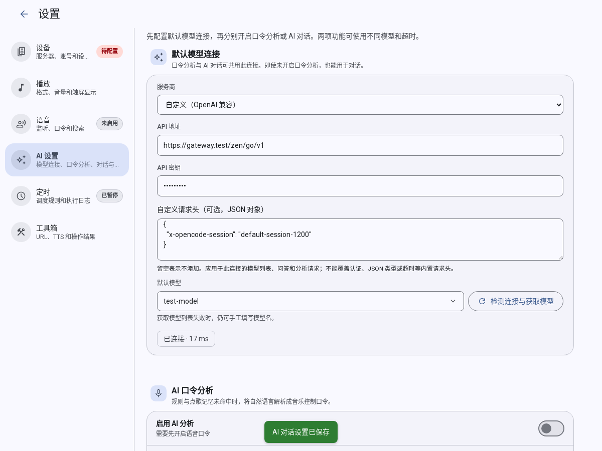
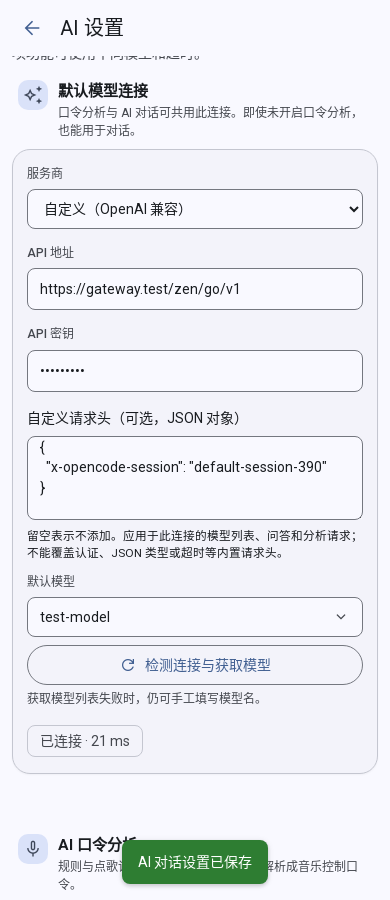

# Issue #133: Custom AI Gateway Headers

- Issue: [songloft-org/songloft-plugin-miot#133](https://github.com/songloft-org/songloft-plugin-miot/issues/133). The report describes an OpenCode gateway `MissingSessionID` response. At investigation time it was open with no comments or linked fixes. Local and remote baseline: `af05c60c1a1504b98dfad2ad955df374100f9dbf`; parent repository: `4b9b6961967e8ea9560461e00a8736f6ad13e24b`. The initial worktrees were clean.
- Cause: the chat client, both model-list handlers, and command analysis separately constructed fixed headers. Neither connection exposed custom headers, and `chatConnection` did not forward them.
- Implementation: the issue's general option A adds a `custom_headers` string object and a JSON settings field. Shared chat uses the default connection's headers; independent chat uses its own. Model lists, streaming/ordinary chat, summaries, memory, and analysis share the header builder. Old configurations add no headers. Blank input or `{}` clears them. Validation and credential redaction are documented in [AI Chat](ai-chat.md#custom-request-headers). Session values are not generated or rotated automatically.

## Verification

2026-10-28, Linux x86_64 / Node 22.17.1 / TypeScript / Docker Chrome 121. Checks cover the plugin baseline above plus this uncommitted worktree. Diff and untracked-file SHA-256 identities are recorded in `/tmp/miot-133-20261028/verification.json`.

| Check | Result and evidence (all under `/tmp/miot-133-20261028/`) |
| --- | --- |
| `npx tsc --noEmit` | Passed, `typecheck-final.log` |
| `node --experimental-strip-types --test tests/*.test.mjs` | 1327 passed, `tests-final.log` |
| Frontend `npm run typecheck`, `npm test` | Passed, 76 tests, `frontend-typecheck-final.log`, `frontend-tests-final.log` |
| `npm run build` | Frontend and QuickJS bytecode passed, `build-final.log` |
| `npm run validate` | Passed, `validate-final.log` |
| New regressions against isolated old source | All 23 failed for missing target behavior: persistence/connection selection, header forwarding, invalid configuration, and credential redaction; `negative-final.log` |
| Docker Chrome UI | Both 1200px and 390px passed saving, reload, model detection, independent connections, preserving valid storage, and clearing; `browser-result.json`, `browser-1200.png`, `browser-390.png` |
| Formatting, self-review, `git diff --check` | Passed; reviewed all four requests, streaming, background calls, connection isolation, and stale model results |

The browser used the actual built frontend, configuration/model-list handlers, and ConfigManager with temporary file storage. `browser-storage.json` and `upstream.json` confirm persisted settings and outgoing headers. Gateway responses and other page APIs were fixtures, not real service or device acceptance.

Not run: the real OpenCode gateway (no dedicated test credentials supplied), OH2/S12 speech and native WebView, long-running use; parent Go checks (host unchanged); remote fix CI (not committed or pushed, no runs found for the baseline SHA).

## Test Screenshots

These original screenshots were captured during the browser interactions above, using a gateway fixture.

This record describes the validation before committing. The user has authorized committing, pushing, and replying to the Issue with screenshots. Subsequent commits, automatic releases, and CI results are recorded on GitHub for the corresponding SHA and in the Issue reply. The parent gitlink is synchronized after committing the plugin.
